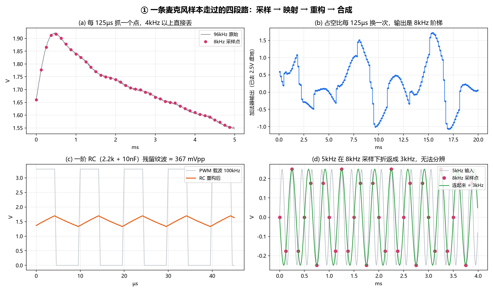
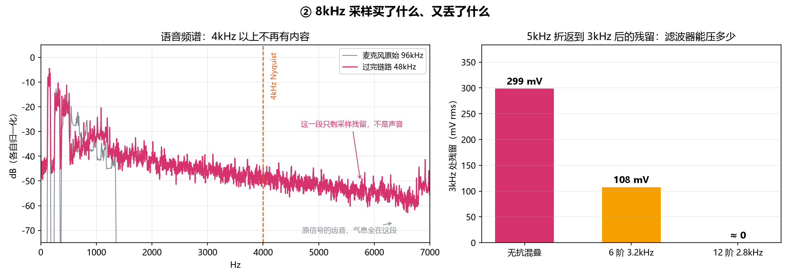
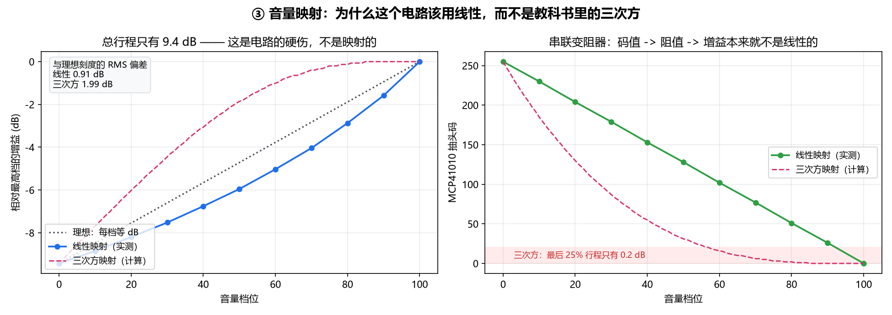

# STM32 线控耳机 K 歌系统

[](https://github.com/tan0528/stm32-karaoke-headset/actions/workflows/ci.yml)

外部播放器的**双声道音乐走模拟直通**，麦克风人声走 **8kHz ADC + DMA + PWM** 的数字化支路，
两路在一个运放加法器上汇合，再经功放送到耳机和扬声器。主控 STM32F103。

仓库里有四样东西：

| 目录 | 内容 |
|---|---|
| `firmware/` | 与平台无关的音频核心（整数、可重入、无 HAL）+ STM32 HAL 对接层 |
| `sim/` | PC 端"数字孪生"：把板子和外设换成一段 C，跑真实的固件代码 |
| `tests/` | 38 个用例 / 105 项断言，纯 C，不依赖第三方框架 |
| `docs/` | 架构与硬件说明、重绘的原理图、测量图 |

## 为什么会有这个仓库

年代久远，板子还回去了。只剩一张原理图和流水账。
于是把能脱离硬件验证的部分全部搬到了 PC 上：

**同一份 `firmware/audio_core.c`，在 STM32 上由 HAL 回调驱动，在 PC 上由假 DMA 驱动。**
时基、DMA 的循环缓冲语义、PWM 载波、RC 重构、加法器的虚地求和，都在仿真里重建了一遍。
这样算出来的增益结构、缓冲延迟、时序预算，和板子上是同一套数字。

仿真给不了的是板级噪声、麦克风真实灵敏度、面包板寄生参数，以及"在示波器前调两天"这件事本身。
它也不验证 CubeMX 的外设配置 —— 那个只能上板。

## 系统结构

```
                      ┌────────── 模拟直通（保留立体声与全带宽）──────────────────────┐
 外部播放器 L/R ──────┤ CD4066(U1 A/B) ── MCP41010(U5/U6) ──┐                      │
                      └───────────────────────────────────────┤                      │
                                                              │                      │
 麦克风 ─► 前置放大 ─► ADC1_IN0 ─► DMA 循环 ─► audio_core ─► TIM2 PWM ─► RC 重构 ────┤
            1.65V 偏置      ▲                    │                                  │
                          TIM3 TRGO              8kHz                                 │
                          8kHz                                                        ▼
                                                       NE5532 加法器 ──┬──► CD4066(U2) ──► 耳机
                                                                       └──► TDA2822 ───► 扬声器
```

三条通路的边界是这套设计的关键：

- **主音乐**不数字化。8kHz 采样连同 4kHz 带宽限制只为语音服务，套到音乐上会直接砍掉高频和立体声。
- **人声**必须数字化，因为要做软件增益、限幅，还要和伴奏混合。
- **控制**（音量、静音、输出选择）走 SPI/GPIO，和音频通路解耦。

## 三个频率，别混

| 量 | 数值 | 含义 |
|---|---|---|
| TIM3 输入时钟 | 72 MHz | APB1 为 36MHz，定时器时钟自动翻倍 |
| ADC 采样率 | 8 kHz | `PSC=71, ARR=124` → 72M/72/125 |
| PWM 载波 | 100 kHz | `PSC=0, ARR=719` → 72M/720 |
| 占空比更新率 | 8 kHz | 载波一直跑，只有 CCR 按 8kHz 换 |

把后两行混为一谈是最典型的错误：以为"每秒更新十万个样本"，实际声音会快 12.5 倍。

## 快速开始

```bash
make            # 编译 build/sim 与 build/tests
make test       # 38 个用例
make demo       # 生成输入信号 → 跑全链路 → 出图（需 numpy / matplotlib）
```

Windows 下用 Git Bash 自带的 sh，`make` 换成 `mingw32-make`。
`make demo` 需要 `pip install numpy matplotlib`。

单独跑一次仿真：

```bash
build/sim out/mic_96k.raw out/music_48k.raw out/mix.raw out/probe.csv 100 256 2.0
#           麦克风输入      音乐输入         输出        波形探针  音量 增益 CPU耗时
```

## 实测结果

`make demo` 的输出，3 秒素材：

| 项 | 结果 |
|---|---|
| ADC 触发次数 | 24000 次 / 3s = 8kHz ✓ |
| 启动延迟 | 127 次 underrun ≈ 15.9ms（一个半缓冲） |
| CPU 每块 18ms（窗口只有 16ms） | 丢块 + 持续 underrun，听感是断音 |
| 音量档 100 / 0 增益 | 3.96x (12.0 dB) / 1.34x (2.5 dB) |
| 音量总行程 | **9.4 dB** |
| 削顶比例 | 0.27%（音乐 0.30V + 人声 0.28V 进 ±2.1V 摆幅） |
| 单级 RC 残留纹波 | **367 mVpp** |
| 5kHz 输入在 8kHz 采样下 | 折返成 3kHz，采样点与 3kHz 曲线偏差 0.0V |
| 抗混叠残留（3kHz 处） | 无滤波 299mV → 6 阶 108mV → 12 阶 ≈ 0 |

三张图（`make demo` 生成）：





`out/*.wav` 可以直接听：`3_合成输出_音量100.wav` 是人声和伴奏混在一起的效果，
`2_麦克风干声_8k.wav` 是标准的"电话音"。

## 测试覆盖

```
=== audio_core: 块处理 ===   恒等、增益、上下限幅、静音、越界、单调性
=== volume: 音量映射 ===     方向、端点、两种映射曲线、阻值模型、增益行程
=== key: 线控按键 ===        阈值边界、按下沿唯一、长按不重复、毛刺抑制、重新触发
=== engine: 端到端 ===       时基、启动延迟、直流精度、增益、声道隔离、
                             5kHz 折返、CPU 超时、削顶、音量能量、参数校验
```

几条测试值得单独说，因为它们把"设计决策"变成了可执行的断言：

- `t_aliasing_5k_equals_3k`：5kHz 与 3kHz 输入在输出端的 3kHz 分量必须相等（差 <3%）——
  这是 8kHz 采样不可逆的代价，写进测试是为了让"提高采样率"的动机可量化。
- `t_linear_beats_cubic`：本拓扑下线性映射比三次方映射更接近"每档等 dB"（0.91 vs 1.99 dB RMS）。
- `t_gain_range`：把 9.4dB 的行程钉死在 [9,10]，谁改了电阻这里会立刻响。

## 已知问题

**设计的真实边界**，都写进了 `docs/architecture.md`：

1. **音量总行程只有 9.4dB。** 数字电位器接成串联变阻器，与 R8=5k 分压，
   抽头从 52Ω 变到 9961Ω 只让增益从 3.96 落到 1.34。正常音量控制需要 40dB 以上。
   修法：改成分压接法（A 端接信号、B 端接地、W 端取输出），代价是增益范围仍需 >1。
2. **单级 RC 压不住 100kHz 载波。** 2.2k + 10nF 的 `fc=7.2kHz`，算出来 367mVpp，
   和麦克风信号（±280mV）同量级。要压到毫伏级需要二阶以上有源滤波。
3. **ADC1_IN0 被两个信号分时占用。** 麦克风前置输出与耳机线控分压共用 PA0，
   K 歌模式下线控读数被前置放大主导（1.65V ≈ 2048 counts），会误判成"音量+"。
   固件在 K 歌模式暂停线控扫描，属于妥协而非修复。
4. **8kHz 只保留 4kHz 带宽。** 语音够用，唱歌只能算"能听出调"。
5. **满音量时 0.27% 削顶。** 音乐 0.30V × 3.96 + 人声 0.28V × 4 > ±2.1V 摆幅。
   修法：降低前级增益，或把加法器的反馈电阻 R1 从 20k 降到 15k。

## 仓库结构

```
firmware/
  audio_core.{h,c}      与平台无关的核心：块处理、音量映射、按键状态机
  audio_calc.h          设计期浮点计算（增益、dB、RC 截止频率）
  stm32/                HAL 对接层（不参与 PC 构建）
    app_audio.c         ADC/DMA 回调、8kHz 时基、启动顺序
    app_control.c       按键 → 状态 → 执行器
    drv_mcp41010.c      软件 SPI 驱动数字电位器
    drv_cd4066.c        模拟开关：静音 / 输出选择 / K 歌使能
    board_pins.h        引脚分配
sim/
  sim_engine.{h,c}      数字孪生内核（纯函数，缓冲入参）
  sim_cli.c             命令行前端
tests/                  38 个用例
tools/
  gen_inputs.py         合成人声、立体声音乐、5kHz 探针
  analyze.py            跑场景、出图、写 WAV
docs/
  architecture.md       信号链、时序推导、设计决策
  hardware.md           器件清单、引脚表、模拟参数
  schematic/            重绘的原理图（SVG + PNG）
```

## 移植到真实硬件

见 `firmware/stm32/README.md`。要点是：CubeMX 里把 ADC 的外部触发设成 TIM3_TRGO、
关掉连续转换、DMA 用循环模式；然后在 `main()` 里按
**先开 PWM 载波 → 再挂 ADC/DMA → 最后开 8kHz 时基** 的顺序启动。

## 许可

MIT，见 [LICENSE](LICENSE)。
